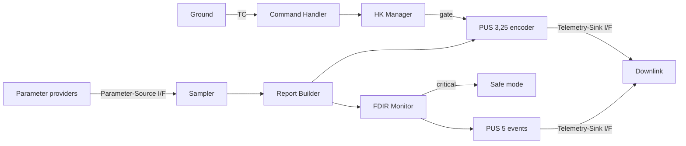

# Flight Software SDLC: Housekeeping Telemetry Service

An onboard housekeeping telemetry service for a satellite computer, built
under a complete, traceable software life cycle (ECSS-E-ST-40C,
ECSS-Q-ST-80C). Operators know a spacecraft's health only through its
telemetry. This service samples 32 health parameters every second, sends
a CCSDS / PUS Service 3 housekeeping report every four seconds on ground
command, and watches every parameter onboard: confirmed limit violations
are reported as PUS Service 5 events, and a critical one puts the unit in
safe mode until ground clears it. It runs on RTEMS 7 (sparc/leon3) under
Renode. Every requirement traces to design, code and a verification
result.



**Status (v1.0):** 31 requirements, 29 verified, 2 partial with closure
actions, 0 failed. 66/66 unit tests, 10/10 system tests on target. 0 MISRA
C:2012 Mandatory or Required findings, gated in CI. 1,260 lines of flight
C (cloc, code lines only; see the technical report §4 for the method).

## Project links

| | |
|---|---|
| Technical report | [docs/technical-report.md](docs/technical-report.md) |
| Project website | _pending: published at the portfolio stage, after the final review_ |
| Release | _pending: `v1.0` is tagged after the final review and defense are accepted_ |
| Author | Dat Nguyen, [GitHub](https://github.com/datnguyen31) |

| Read | For |
|---|---|
| [Technical report](docs/technical-report.md) | The whole story, from mission need to verified result |
| [Verification and validation report](docs/verification-report.md) | What is verified, by what, and what is open |
| [Traceability matrix](verification/traceability-matrix.md) | Requirement → design → code → test → status |
| [Release notes](docs/release-notes-v1.0.md) | What v1.0 contains |
| [Design decisions](design/design-decisions.md) | DD-01 to DD-18, each with its rationale, including DD-18 (Renode, not QEMU) |
| [Coding standard](docs/coding-standard.md) | MISRA C:2012 subset, house rules, and how CI enforces them |

## Repository layout

1. `requirements/`: baseline and FDIR-increment requirements, each with a rationale, parent and verification method
2. `design/`: architecture, data model, detailed and FDIR design, design decisions DD-01 to DD-18
3. `src/app`: the onboard application (logic in `src/`, RTEMS tasks in `tasks/`, platform in `rtems/`)
4. `src/fdir`: fault detection, isolation and recovery, kept separate for clarity and review
5. `test/`: unit tests (host, Unity) and system tests (target, ST-01 to ST-10)
6. `verification/`: traceability matrix, timing analysis and measurement, system test spec and results, ISVV record
7. `docs/`: development plan, coding standard, verification report, technical report, defense walkthrough
8. `ci/`, `.github/workflows/`: CI pipeline (build, unit tests, static analysis, MISRA gate, target build)

## Build

Host build (unit tests via ctest):

```sh
cmake -S . -B build
cmake --build build
ctest --test-dir build
```

MISRA C:2012 gate, as CI runs it (needs cppcheck with its MISRA addon):

```sh
python3 ci/misra_gate.py
```

Cross-build for RTEMS 7, BSP sparc/leon3 (DD-09), against the toolchain
installed at `/opt/rtems7`, and run end to end on Renode:

```sh
cmake -S . -B build-target -DCMAKE_TOOLCHAIN_FILE=cmake/toolchain-rtems.cmake
cmake --build build-target
RENODE=/path/to/renode tools/renode/run_hk_app.sh   # or: cmake --build build-target --target run_renode
```

This produces `build-target/src/app/rtems/hk_app.exe`, the HK-TM service
image, then runs it for 27 s of virtual time on Renode's LEON3 platform. The
image's `Init` plays a scripted ground station: ENABLE_REPORTS, an unknown
telecommand, then DISABLE_REPORTS. `tools/hk_tm_decode.py` then decodes every
`TM` packet on the console independently of the flight encoder and checks
it, including each value against the decoder's own copy of the FDIR limits.
FDIR event reports (PUS TM[5,s], APID `0x0CB`) are decoded too. The nominal
run expects none. To watch it interactively instead:

```sh
renode -e '$bin=@build-target/src/app/rtems/hk_app.exe; include @tools/renode/hk_leon3.resc; showAnalyzer uart; start'
```

### System tests (Session 9)

The same build also produces `build-target/test/system/hk_system_test.exe`,
the service with a test rig in place of the simulator and the ground script:
a representative parameter provider with a fault injector, and a scripted
command injector. It runs system tests ST-01 to ST-10
(`verification/system-test-spec.md`). `test/system/st_capture.py` checks each
one from the captured telemetry:

```sh
RENODE=/path/to/renode test/system/run_system_tests.sh   # or: cmake --build build-target --target run_system_tests
# Long run for the timing measurement (verification/timing-measured.md):
RENODE=/path/to/renode RENODE_QUANTUM=0.00001 test/system/run_system_tests.sh <exe> 300
```

Other installed BSPs use the same toolchain file, e.g. `-DRTEMS_BSP=erc32`
(runs under `sparc-rtems7-sis -r`). For RTEMS 6 arm/beagleboneblack on real
hardware (DD-08), use the preset
`-DCMAKE_TOOLCHAIN_FILE=cmake/toolchain-rtems-beagleboneblack.cmake`. If
`mkimage` is available (`sudo apt install u-boot-tools`), that build also
produces `hk_app.img`, a U-Boot loadable image ready to TFTP-boot.

Unit tests only build for the host and are skipped when cross-compiling.
CI runs the target build and the Renode run in the `target-build` job, using
the image from `tools/docker/rtems7-leon3.Dockerfile`. That job is skipped
until the repository variable `RTEMS_TOOLCHAIN_IMAGE` names a published image.
