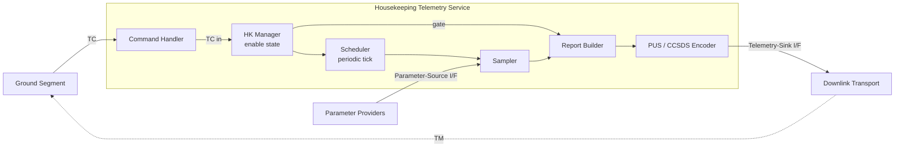
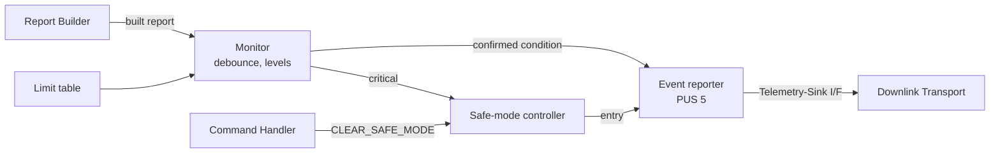

# HK-TM Architecture

## Overview

The service is decomposed into six internal components behind two external
interfaces. Data flows left to right along the pipeline; control flows from
the command path into the manager, which gates reporting and drives the
scheduler.

*Navy/internal components: Scheduler, HK Manager, Command Handler, Sampler,
Report Builder, PUS/CCSDS Encoder. External actors: Ground Segment,
Parameter Providers, Downlink Transport. The Parameter-Source and
Telemetry-Sink interfaces are the two designed contracts (Part 3).*

## Component Responsibilities

| Component | Responsibility |
|---|---|
| Scheduler | Provides the periodic collection tick and counts ticks to decide when a report is due (HKS-SR-020, 060, 140). |
| Sampler | Reads each parameter through the parameter-source interface once per tick; marks missing values stale (HKS-SR-020, 040). |
| Report Builder | Assembles the sampled values into the fixed report structure and stamps it with onboard collection time (HKS-SR-050, 070). |
| PUS / CCSDS Encoder | Encodes the report as a PUS Service 3 housekeeping telemetry packet (HKS-SR-080). |
| HK Manager | Holds the enabled/disabled state, applies command results, and gates whether the Report Builder output is emitted (HKS-SR-100, 110, 120). |
| Command Handler | Validates incoming telecommands and dispatches enable/disable, rejecting malformed commands without state change (HKS-SR-130). Since Session 8 it also dispatches CLEAR_SAFE_MODE (HKS-FD-080). |

### FDIR increment (Session 8)

Four further components, in `src/fdir`, attach to the pipeline above at
one point. The monitor checks each built report before the report gate,
and its events leave through the same Telemetry-Sink interface. Design:
`design/fdir-design.md`.

| Component | Responsibility |
|---|---|
| Limit table | Soft and hard, low and high limits per parameter; classification of a value (HKS-FD-010). |
| Monitor | Checks every parameter once per collection cycle, debounces, keeps each parameter's confirmed level and escalates, counts stale cycles (HKS-FD-020, 030, 050, 060, 070). |
| Event reporter | Encodes PUS Service 5 event reports and emits them through the telemetry sink (HKS-FD-040, 050). |
| Safe-mode controller | Holds the safe-mode indicator: entered on a critical condition, cleared only by ground command (HKS-FD-060, 080). |

## Concurrency Model

Two tasks, statically defined (HKS-SR-180). The collection task is periodic
and time-critical; the command task is event-driven and reacts to uplink.
Command handling runs at a higher priority so an enable/disable is not
delayed by a collection cycle, but it does no heavy work, so it cannot
starve collection.

| Task | Priority | Timing | Role |
|---|---|---|---|
| HK collection task | Medium | Periodic, 1000 ms | Sample, build, and on the report divider encode and emit. Uses RTEMS's rate-monotonic period service to bound jitter (HKS-SR-140). |
| Command task | Higher | Event, on uplink | Receives a telecommand from a queue, validates, and dispatches to the HK Manager (or, for CLEAR_SAFE_MODE, the safe-mode controller). No blocking work. |

The FDIR increment adds no task. The monitor and every event emission run
in the collection task. The only state FDIR shares between the tasks is
the safe-mode indicator, guarded by the same critical section as the
reporting flag (`design/fdir-design.md` §5).

> The 50 ms collection budget (HKS-SR-150) is verified by timing analysis in
> Session 5, once the sampler and encoder internals are designed. It's
> called out here so the design keeps the per-tick work small.