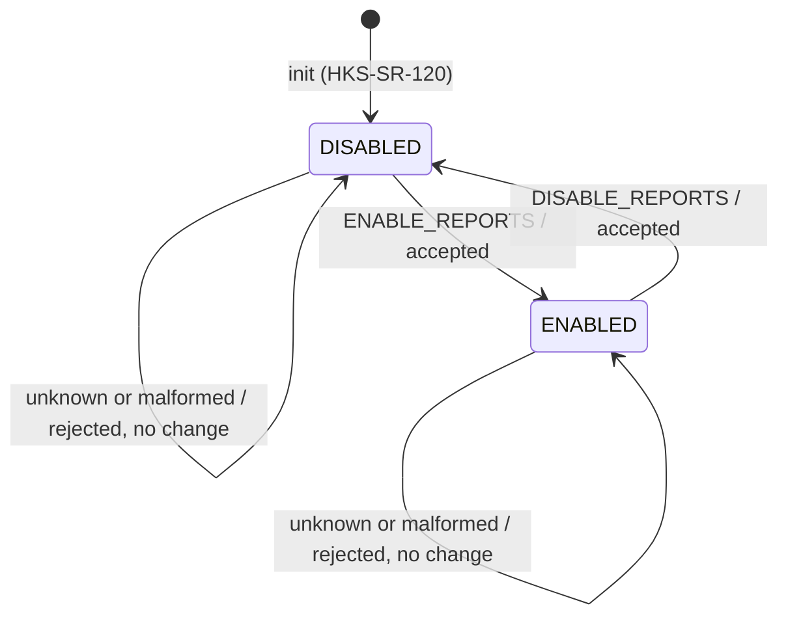

# HK-TM Detailed Design

Session 4 gave the service its shape: six components, two designed
interfaces, a report model. This document fills in the internals of each
component and the command/reporting state model, to a level of detail two
engineers would implement the same way. It is behaviour, not code —
implementation follows in Session 6–7.

## 1.1 Scheduler and the collection cycle

The collection task is released periodically by the RTEMS rate-monotonic
period service, per DD-06. On each release it runs one collection cycle and
counts releases with a report divider; when the divider reaches the ratio
of generation interval to collection interval (4, from the HKS-SR-020/060
defaults of 1000 ms and 4000 ms), a report is emitted and the divider
resets. This is DD-01: one period drives both rates, so a report is always
built from a just-completed collection.

The report is built on every release, whether or not it is a report tick,
and whether or not reporting is enabled. Building unconditionally keeps
per-tick timing constant regardless of state, which is what makes the
budget in Part 2 independent of enable/disable and of the report cadence.

```
collection_task():
    rtems_rate_monotonic_create(&period_id)
    divider = 0
    loop forever:
        rtems_rate_monotonic_period(period_id, COLLECTION_TICKS)  # blocks to next release
        sample_all_parameters()                                  # 1.2, into working set
        hk_manager_on_tick()                                      # sync hook, no state effect today
        report = build_report(working_set, collection_time)       # 1.3, unconditional
        divider = divider + 1
        if divider == REPORT_DIVIDER:          # 4 for baseline (HKS-SR-060)
            divider = 0
            if hk_manager_reports_enabled():   # gate (HKS-SR-100/110/120)
                packet = encode_pus_3_25(report)  # 1.4
                sent = hk_tm_sink_send(packet, length)
                if not sent:  handle_sink_rejection()  # return value checked (coding-standard.md rule 7)
```

`hk_manager_on_tick()` is called every release, not only on report ticks. It
does no work in the baseline; it exists as the synchronization point the
HK Manager interface reserves for later per-tick concerns (e.g. an FDIR
health check) without changing the Scheduler's contract when that need
arrives.

## 1.2 Sampler

The Sampler walks the fixed parameter table (HKS-SR-010) and calls
`hk_param_source_read()` once per parameter. A call that does not return
`HK_PARAM_OK` — whether `HK_PARAM_STALE` or `HK_PARAM_UNKNOWN` — causes the
Sampler to write that parameter's defined stale marker into the working set
and continue to the next parameter (HKS-SR-040). One failing or absent
source never stops the cycle; the read is non-blocking and time-bounded by
contract with the parameter-source interface.

## 1.3 Report Builder

The Builder copies the working set into the fixed report structure in
defined parameter order (HKS-SR-050) and records the onboard collection
time as a CUC timestamp (HKS-SR-070, HKS-SR-030 data model). The report
buffer is statically sized at build time for the baseline parameter count
(HKS-SR-160, DD-02); no allocation occurs on this path.

## 1.4 PUS / CCSDS Encoder

The encoder writes the CCSDS primary header, the PUS TM secondary header
with service 3 and subtype 25, then the source data (structure identifier
plus parameter values), all big-endian (HKS-SR-080). Packet data length is
back-filled once the source data length is known. A packet error control
field is not required by the baseline requirements; if added later it is
appended after the source data without changing this design. The encoder is
pure — report in, byte buffer out — which is what makes it unit-testable
against known vectors independent of the Telemetry-Sink.

## 1.5 Command path and reporting state model

The command task receives a telecommand, `hk_command_dispatch()` validates
it, and a valid enable or disable updates a single reporting-state flag
owned by the HK Manager. The state model is two states, starting DISABLED
at initialization (HKS-SR-120, DD-04).



Malformed or unknown commands are rejected in either state with no
transition (HKS-SR-130). Validation is explicit and ordered, and a rejected
command changes nothing:

```
hk_command_dispatch(cmd):
    if cmd not in { HK_CMD_ENABLE_REPORTS, HK_CMD_DISABLE_REPORTS }:
        return HK_CMD_REJECTED          # unknown opcode, no change (SR-130)
    enter_critical_section()            # guard shared flag (1.6)
    if cmd == HK_CMD_ENABLE_REPORTS:  hk_manager_set_reports_enabled(true)
    else:                             hk_manager_set_reports_enabled(false)
    leave_critical_section()
    return HK_CMD_ACCEPTED
```

`hk_manager_set_reports_enabled()` is a small addition to `hk_manager.h`
alongside the existing `hk_manager_reports_enabled()` getter (DD-07): the
Command Handler needs a way to mutate the state the HK Manager owns, and
Session 4 defined the read side but not the write side.

## 1.6 Concurrency resolution

The reporting-state flag is written by the command task and read by the
collection task, so it is shared mutable state between the two tasks in
the model in `architecture.md`. The collection task reads it once per
report decision; the command task writes it on uplink. To avoid a torn or
stale read, the write in 1.5 is wrapped in a short critical section (a
brief interrupt lock or binary semaphore under RTEMS — the specific
primitive is an implementation choice for Session 6/7, not a design
constraint here). The read in the collection task is a single access to
a machine word and needs no lock of its own. The critical region is a few
instructions, far below the timing budget, so it does not affect the
analysis in Part 2 of `verification/timing-analysis.md`. This is the kind
of shared-state hazard that is cheap to handle in design and expensive to
debug after the fact, which is why it is called out explicitly here.
