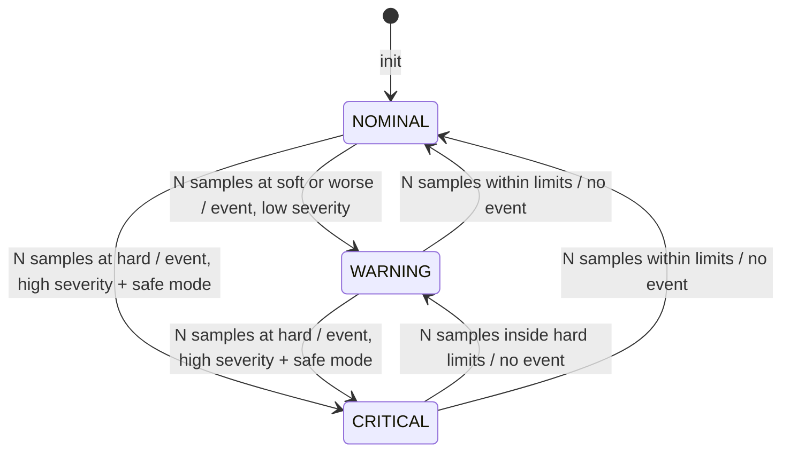

# HK-TM FDIR Design (Session 8 increment)

This document designs the FDIR increment against
`requirements/fdir-increment.md` (HKS-SYS-040, HKS-FD-010 to 090). It
follows `design/detailed-design.md`: behaviour first, at a level of detail
two engineers would implement the same way. The code is in `src/fdir`. The
decisions it records are DD-12 to DD-15 in `design/design-decisions.md`.

## 1. Components and integration

Four components live in `src/fdir`, kept separate from the baseline
application. They reuse the existing interfaces instead of adding new
coupling. The monitor reads the same `hk_report_t` the Sampler and Report
Builder produce. Events go out through the same telemetry-sink interface
as the housekeeping report. The safe-mode indicator uses the existing
critical section.

| Component | Module | Responsibility | Requirements |
|---|---|---|---|
| Limit table | `hk_limits` | Soft and hard, low and high limits per parameter; pure classification of one value. | FD-010 |
| Monitor | `hk_monitor` | Classify each fresh value, debounce, keep each parameter's confirmed level, escalate; count stale cycles. | FD-020, 030, 050, 060, 070 |
| Event reporter | `hk_event` | Encode PUS TM[5,s] event reports and emit them through the telemetry sink. | FD-040, 050, 070, 080 |
| Safe-mode controller | `hk_safemode` | Hold the safe-mode indicator; enter on a critical condition, clear on ground command. | FD-060, 080 |

**Attach points.** The baseline changes in exactly two places:

1. In the collection cycle, `hk_collection_step()` in
   `src/app/src/hk_collection.c` (DD-10 moved the pipeline there from the
   RTEMS task), one line goes after the report is built and before the
   report divider and the enable gate:

   ```c
   hk_sampler_collect(&s_report);
   hk_manager_on_tick();
   hk_report_build(&s_report, now_cuc);
   hk_monitor_check(&s_report);          /* NEW: FDIR (FD-020) */
   /* ... report divider and gated emit unchanged ... */
   ```

   The sampled values and the collection time are already available
   there. Because the call comes before the gate, the monitor runs on every
   cycle, whether reporting is enabled or not: monitoring must not depend
   on whether ground wants the telemetry stream.
   `hk_manager_on_tick()`, which the Session 5 design reserved for "an
   FDIR health check", is not used: it runs before the report is built, so
   it has neither the values nor the time. It stays a no-op.

2. In the command handler, one opcode is added: `HK_CMD_CLEAR_SAFE_MODE = 3`.
   It is validated by the same explicit switch as the others, so an
   unknown or malformed command is still rejected with no effect
   (HKS-SR-130).

The task model, priorities, the concurrency primitive and the reporting
path are unchanged.

## 2. Monitor

### 2.1 Escalation ladder

Each parameter has a confirmed **level**: NOMINAL, WARNING or CRITICAL.
`hk_limit_classify()` sorts each fresh sample into within limits, soft
band (warning) or beyond a hard limit (critical). The level moves only
when HK_DEBOUNCE_N (N, default 3) consecutive fresh samples support the
move (FD-030). The same debounce applies on the way up, so a transient
spike does not trip a fault, and on the way down, so a parameter near a
limit does not flap.



Four run counters per parameter track the consecutive fresh samples that
support each move. Each counter saturates at N, so it cannot wrap:

| Counter | Counts samples | Supports |
|---|---|---|
| `n_warn` | at the soft limit or beyond | NOMINAL to WARNING |
| `n_crit` | at the hard limit or beyond | any level to CRITICAL |
| `n_ok` | within limits | any level to NOMINAL |
| `n_noncrit` | inside the hard limits | CRITICAL to WARNING |

The rules are evaluated in this order, and the first match wins:
`n_crit = N` gives CRITICAL; `n_ok = N` gives NOMINAL; at NOMINAL,
`n_warn = N` gives WARNING; at CRITICAL, `n_noncrit = N` gives WARNING.
Otherwise the level holds.

`n_warn` counts soft and hard samples together. As a result, N
consecutive out-of-limit samples always confirm at least a warning, even
if they are a mix of soft and hard. That is the plain reading of FD-030.

### 2.2 Actions

A **rise** in level is a newly confirmed condition. It emits one limit
event (FD-040), with the parameter and the condition: the new level's
severity, on the side (low or high) of the confirming sample. A rise to
CRITICAL also calls `hk_safemode_enter()` (FD-060). A fall emits nothing.
So a sustained condition is reported once, not every cycle. When a
parameter falls back, its monitor is re-armed, and a relapse is reported
again.

### 2.3 Stale parameters

A sample whose status is not `HK_PARAM_OK` carries only the stale marker,
not a value. It is not classified, and it neither counts toward nor breaks
a limit run. Instead it advances `n_stale`, which saturates at
HK_STALE_M (M, default 3). The step from M-1 to M emits one stale event
(FD-070). The first fresh sample resets `n_stale`, so the next stale run
is reported again. A stale parameter does not enter safe mode: FD-070 asks
for an event, and a silent sensor is not evidence that the quantity it
measures is out of limits.

### 2.4 Departures from the session reference sketch

The Session 8 brief sketches the monitor with one violation counter per
parameter that fires when the counter equals N, and a stale counter that
fires when it equals M. Implemented as sketched, it has two defects, so
this design differs (DD-13):

- The counters stop incrementing at N (or M), so the "equals" test is
  true on every later cycle of a sustained condition. The condition is
  then re-reported every cycle, and `hk_safemode_enter()` is called every
  cycle. That contradicts the brief's own "acted on exactly once" note.
  Here an action fires only on the transition (a rise in level, or the
  stale count reaching M).
- One counter cannot climb the ladder. Once a soft-limit condition has
  confirmed WARNING, the counter sits at N. If the value then crosses the
  hard limit, no critical event follows and safe mode is never entered.
  The separate `n_crit` run fixes this.

`test_hk_monitor.c` has a test for each case. A mutation run that
restored the "fire every cycle once saturated" behaviour failed five of
them.

## 3. Event reports (PUS Service 5)

The event packet layout is in `design/data-model.md`, "Event report". The
three entry points, `hk_event_limit()`, `hk_event_stale()` and
`hk_event_safe_mode()`, are thin wrappers over one encoder. That encoder
uses the shared header and PEC writers in `hk_pus_encoder.h`. A warning
and a critical event differ only in subtype and condition.

| Event | Event id | Subtype (severity) | Parameter | Condition |
|---|---|---|---|---|
| Limit, warning | 1 | 2 (low) | the parameter | `HK_WARN_LOW` / `HK_WARN_HIGH` |
| Limit, critical | 1 | 4 (high) | the parameter | `HK_CRIT_LOW` / `HK_CRIT_HIGH` |
| Stale | 2 | 3 (medium) | the parameter | its last status (`STALE` / `UNKNOWN`) |
| Safe mode entered | 3 | 4 (high) | `0x0000` | 0 |

- **Own APID (DD-12).** Events are sent on APID `0x0CB`, with their own
  14-bit sequence count. The housekeeping stream on `0x0CA` keeps its
  count and cadence exactly as verified in Session 7.
- **Time.** Each event carries the collection time of the report that
  confirmed it (DD-12). It is passed down explicitly, not read from a
  clock, so the event and the housekeeping packet for the same cycle carry
  the same timestamp.
- **Not gated.** Events are emitted whether periodic reporting is enabled
  or not. HKS-SR-100 to 120 control the periodic housekeeping stream.
  They are not a switch for fault reporting.
- **Sink rejection.** A dropped event is not retried. The confirmed level
  and the safe-mode indicator are already set, and the housekeeping values
  still show the condition. The sequence count advances on the dropped
  packet, so ground sees a gap.

## 4. Safe-mode controller

`hk_safemode` owns a single indicator. The collection task sets it through
the monitor. The command task clears it on `CLEAR_SAFE_MODE`. It is the
second piece of state shared between the two tasks, after the reporting
flag (detailed-design.md §1.6). It is guarded the same way: every access
is inside `hk_critical_enter()` / `hk_critical_leave()` in the owning
module (DD-07, DD-11), using the same priority-inheritance mutex, so the
RTEMS object count does not change.

- **Entry** is idempotent. Only the call that makes the transition from
  inactive sends the safe-mode event (FD-080). The event is sent after the lock is released, so the mutex is
  never held across the sink. The hook for system-level safing actions is
  marked at the same point (scope boundary,
  `requirements/fdir-increment.md`).
- **Recovery** is by ground command only (FD-080). No code path in FDIR
  clears the indicator.
- **Clearing while the condition persists** does not re-enter safe mode.
  The condition was already acted on, and the parameter stays CRITICAL
  without a new rise. Operators who clear safe mode with a known fault
  present are taking responsibility for it. Re-entering immediately would
  make the command useless. If the parameter recovers and then relapses,
  safe mode is entered again.
- The indicator is shown on each `[hk] cycle` console line of the target
  image (`[SAFE MODE]`). It is not added to the housekeeping report,
  whose structure is fixed for the baseline (HKS-SR-050, DD-05).

## 5. Concurrency

| State | Written by | Read by | Protection |
|---|---|---|---|
| Per-parameter monitor state | collection task | collection task | none needed |
| Event packet buffer, event sequence count | collection task | collection task | none needed |
| Safe-mode indicator | collection task (enter), command task (clear) | both | critical section |
| Telemetry sink | collection task only (HK and events) | — | single caller |

Everything that emits telemetry runs in the collection task, so the sink
still has one caller. `CLEAR_SAFE_MODE` emits nothing from the command
task. Ground sees the command accepted on its own command path.

## 6. Resources and timing (HKS-FD-090)

All FDIR state is static: the monitor state for the parameters, a 24-byte
event packet buffer, a sequence count and one flag. There is no
allocation on any path. The added work per cycle is bounded by the fixed
parameter count. Event encoding happens only when a level rises: at most
one limit event per parameter per cycle, plus one safe-mode event.
`test_worst_case_event_burst_is_bounded` checks that bound. Timing is
re-analyzed in `verification/timing-analysis.md`.

## 7. Limit data

Limits are raw 12-bit ADC counts, the unit the parameters are sampled in.
Calibration to engineering units is a ground function. Every row keeps
`0` and `4095`, an open or shorted sensor, beyond its hard limits. The
values are illustrative (DD-14). Two consumers outside flight code must
agree with the table, and both are checked:

- The host stub source returns the middle of each soft band, and the
  target simulator returns the middle plus `cycle % 64`. Both are
  therefore nominal, so the baseline tests and the Session 7 end-to-end
  run raise no events. `test_hk_limits.c` checks every band is wide
  enough.
- `tools/hk_tm_decode.py` holds its own copy of the limits, as a ground
  mission database would. It checks each received value against them,
  independently of the flight table.
