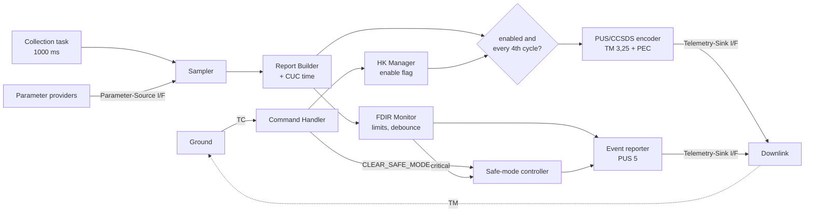

# Housekeeping Telemetry Service: a Flight Software Life Cycle, End to End

**Capstone technical report, v1.0.** Dat Nguyen, Spacecraft Software
Engineer Program, 2026.

## Summary

This project built an onboard Housekeeping Telemetry Service (HK-TM) for a
satellite computer and carried it through a complete, traceable software
life cycle: requirements, architecture, detailed design, implementation,
a fault-management increment, verification at three levels, an
independent-verification plan, and validation against the mission need.
The service runs on RTEMS 7 on an emulated LEON3 processor. It samples 32
health parameters every second, sends a CCSDS/PUS housekeeping report
every four seconds on ground command, monitors every parameter against
two-level limits, reports confirmed conditions as PUS Service 5 events,
and enters safe mode on a critical one.

31 requirements were baselined. 29 are verified by their assigned method
and two are partial, each with a defined closure action. Every requirement
traces to a design element, to code, and to its verification result
(Appendix A). The process around the code is what this project is about.
The code is small, 1,260 lines of flight C, so that every line of the
process stays visible (counted as in §4, "Code size").

## 1. Mission context and objective

A spacecraft's operators cannot see it. Everything they know about its
health comes down the telemetry link: temperatures, voltages, currents,
the state of each unit. Housekeeping telemetry is that stream. If it
stops, is unreadable, or cannot be placed in time, the operators are
blind. And a fault can develop faster than the next ground contact, so
some of the watching has to happen onboard.

The objective was to build this function the way flight software is
built: under ECSS-E-ST-40C engineering and ECSS-Q-ST-80C product
assurance, with every requirement traced and every claim backed by
evidence (`docs/software-development-plan.md`). Fault management and
quality assurance were treated as first-class parts of the work, not
added afterwards.

## 2. Requirements

Requirements were written in Session 3 and baselined as tag
`req-baseline-v0.1`: three system needs and eighteen software
requirements, each with a rationale, a parent, and a verification method
(Test, Analysis, Inspection or Review) chosen when it was written
(`requirements/hk-tm-baseline.md`).

| Area | Requirements | Examples |
|---|---|---|
| System needs | HKS-SYS-010 to 030 | Periodic health telemetry; ground control of it; onboard timestamps |
| Acquisition | HKS-SR-010 to 040 | 32 parameters, 1000 ms sampling, stale marker for a silent source |
| Reporting | HKS-SR-050 to 090 | Fixed report, every 4000 ms, CUC time, PUS TM[3,25], sink interface |
| Command | HKS-SR-100 to 130 | Enable, disable, quiet start, reject bad commands without a state change |
| Timing and resources | HKS-SR-140 to 180 | Jitter < 10 %, cycle < 50 ms, no dynamic allocation, MISRA subset, static RTEMS tasks |

The FDIR increment (Session 8, `requirements/fdir-increment.md`, tag
`fdir-v0.1`) added one system need, HKS-SYS-040 (autonomously detect and
respond to out-of-limit conditions), and nine software requirements,
HKS-FD-010 to 090. It was added alongside the baseline, and did not edit
it. The baseline stayed frozen, and the requirements the increment
affected (SR-150 timing, SR-130 command set) were re-verified, not assumed
to still hold.

Two habits held the requirements under control. Each method was chosen
when the requirement was written, and later evidence never changed it: a
requirement assigned Review stays closed by Review even when tests were
added on top (traceability matrix, "Verification-method control").
And each commit that touches a requirement names it.

## 3. Architecture and design



Six baseline components sit behind two designed interfaces, the
parameter source and the telemetry sink (`design/architecture.md`). The
FDIR increment adds four more in their own directory, `src/fdir`, and
attaches to the pipeline at one point: after a report is built, before
the reporting gate. FDIR therefore checks every sample whether or not
reporting is enabled (`design/fdir-design.md`).

The decisions that shaped the design are recorded with their reasons
(`design/design-decisions.md`). The seven that matter most:

| Decision | What and why |
|---|---|
| DD-01 | **One periodic task with a report divider, not two tasks.** One rate-monotonic period drives collection and a counter decides when to report. Each report is aligned to a completed collection by construction, and there is one timing source to reason about. |
| DD-02 | **Static allocation only.** Every buffer is sized at build time. HKS-SR-160 becomes something an inspection can prove. |
| DD-03 | **Swappable implementations behind pure C interfaces**, chosen at link time, not through function pointers. The same logic links against stubs on the host and real providers on the target, so testability was designed in. |
| DD-04 | **Reporting disabled at start.** A quiet start is safer and easier to verify than autonomous output. |
| DD-07 | **The command handler does not write the flag; it asks the manager.** The manager owns its state and the critical section around it, so the one piece of shared state has one owner. |
| DD-12 | **FDIR events on their own APID**, with their own sequence count, and stamped with the time of the report that confirmed them. The verified housekeeping stream did not change, and an event lines up with its data on the ground. |
| DD-13 | **A confirmed level per parameter, raised by four saturating counters**, acting only when the level rises. The session's reference sketch, taken literally, re-reported a sustained condition every cycle and could not escalate a warning to critical. The departure is recorded, with its reason. |

The detailed design (`design/detailed-design.md`) fixed the per-release
pipeline, the packet layout field by field against CCSDS 133.0-B and
ECSS-E-ST-70-41C (`design/data-model.md`), and the concurrency: a
priority-inheritance semaphore (DD-11) guards the two flags the tasks
share.

## 4. Implementation

The code follows the design's split between logic and platform:

| Layer | Location | Contents |
|---|---|---|
| Logic | `src/app/src`, `src/fdir/src` | Sampler, builder, encoder, manager, command handler, collection step; limits, monitor, events, safe mode. Pure C11, no RTOS calls, unit-tested on the host |
| Tasks | `src/app/tasks` | The two RTEMS tasks: collection (rate-monotonic, priority 20) and command (message queue, priority 10). Each is a thin loop around a logic call |
| Platform | `src/app/rtems` | Startup, RTEMS configuration, RTEMS time source, simulated parameter provider, console sink |

One decision moved code across that line on purpose. DD-10 made the
per-release pipeline a pure C function, `hk_collection_step()`, and left
the RTEMS task as the period loop and the clock. The report divider, the
enable gate and the sink handoff are therefore verified by unit test on
every build, not only on an emulated run.

The data path for one release: the task wakes from its period, reads
onboard time, and calls `hk_collection_step()`. That reads all 32
parameters through the source interface (a silent source gives
`0xFFFFFFFF`), builds the report with its timestamp, and passes it to the
FDIR monitor. If reporting is enabled and this is the fourth cycle, it
encodes a 148-byte TM[3,25] packet with its CRC and hands it to the sink.

The target is RTEMS 7, BSP sparc/leon3, on Renode (DD-09). Getting there
took two boot-loader duties the BSP expects and Renode does not perform:
setting the initial stack pointer (without it the BSP halts before any
console output) and the timer prescaler (without it time runs five times
slow). Both are in `tools/renode/hk_leon3.resc`, with their reasons.

**Why Renode and not QEMU** (DD-18). QEMU's `leon3_generic` machine
models the same LEON3 core and peripherals and was the obvious
alternative. Renode was chosen because the verification needed four things
from the emulator:

1. **Reproducible time.** Renode advances virtual time by executed
   instructions and synchronizes in fixed quanta. The same image gives the
   same timestamps, sequence counts and timing record on every run. The
   system tests re-run on 2026-10-29 and 2026-11-03 reproduced the
   2026-10-16 recorded run exactly (verification report §3.1). By default QEMU ties guest time to the host clock, and its
   `-icount` mode was not evaluated.
2. **Scriptable state and hooks.** The boot-loader duties are two lines of
   the `.resc` script. Hooks on guest functions gave evidence directly: a
   `malloc` hook is the run-time evidence for HKS-SR-160, and hooks on the
   BSP fatal handler located the silent boot fault.
3. **Platform as data.** The machine is a text description, so a
   peripheral, such as a second UART for a queued downlink sink, is added
   without writing a C device model into the emulator.
4. **Headless capture**, which QEMU also offers. It did not decide the
   choice.

The choice has limits. Neither emulator models caches or bus contention,
so emulated timing stays indicative either way (OI-1). Renode also needed
the two boot-loader duties, and its memory growth limits a run to about
300 s. Nothing in the flight code depends on Renode: everything
emulator-specific is in `tools/renode/`, so moving to QEMU or to hardware
needs a new launch script, not a code change. QEMU was not run on this
image.

**Code size.** Counted with cloc 1.90, as non-blank, non-comment lines:

```
cloc --include-lang="C,C/C++ Header" src/app src/fdir
```

| Part | Files | Code lines | Comment lines | Blank lines |
|---|---|---|---|---|
| Flight code, `src/app` and `src/fdir` | 38 | **1,260** (899 C, 361 header) | 497 | 325 |
| of which the RTEMS platform layer, `src/app/rtems` | 7 | 155 | 83 | 48 |
| of which the host-only critical-section double, `hk_critical_host.c` | 1 | 4 | 7 | 4 |
| Unit and system test code and test doubles, `test/` (C only; the Unity framework is fetched at build time, not counted) | 15 | 1,172 | 205 | 216 |
| Ground decoder, test checker, CI gate and run scripts (Python, shell) | 5 | 650 | 82 | 104 |

The headline 1,260 is the flight code: everything under `src/`, the
headers included, with comments and blank lines left out. The physical
line count of the same files is 2,082. The test code is close to the
flight code in size, which is normal for code verified to this depth.

The coding standard (`docs/coding-standard.md`) is the MISRA C:2012
Required set plus ten house rules adapted from JPL's Power of Ten. All
flight code builds with `-Werror -Wconversion -Wshadow -Wpedantic`, and
CI runs cppcheck and a MISRA gate (`ci/misra_gate.py`) on every push. The
gate fails on any Mandatory or Required finding. The six Required findings
of the first MISRA run were corrected in code, not deviated (verification
report §2).

## 5. Fault management

FDIR was built as a life-cycle increment, from its own requirements
through to system test, so that it could be reviewed as a unit.

- **Detection.** Each parameter has soft and hard limits, low and high
  (HKS-FD-010), checked every cycle (FD-020). A condition is confirmed
  only after N = 3 consecutive samples (FD-030), so one noisy sample does
  nothing. A source silent for M = 3 cycles is itself a fault (FD-070).
- **Reporting.** A confirmed condition emits a PUS Service 5 event naming
  the parameter and the condition, with warning or critical severity
  (FD-040, FD-050). A sustained condition is reported once, not every
  cycle, and a warning that worsens escalates to critical.
- **Response.** A confirmed critical condition puts the unit in safe mode:
  an indicator is set and a safe-mode event is sent (FD-060, FD-080).
  Recovery is by ground command only. Automatic recovery while a real
  fault persists would make the spacecraft cycle in and out of safe mode,
  which is worse than staying safe.
- **Cost.** All FDIR state is static, and the monitor adds about 176 µs
  to the cycle by analysis (FD-090).

Safe mode here signals; it does not perform safing. Load shedding and
attitude changes are system-level behaviour, and the code marks the hook
where they would go.

## 6. Verification and validation

Verification ran at three levels against the requirements, as the V-model
in the SDP plans it.

**Unit.** 10 Unity suites, 66 test cases, on the host, through the same
interfaces the target uses, with stubs at the edges. The encoder is
checked against a byte-exact 148-byte vector. The debounce is tested at
every boundary.

**Integration.** The flight image runs on Renode against a scripted ground
station. Every packet it emits is decoded by `tools/hk_tm_decode.py`, a
ground decoder written separately from the flight encoder, which also
checks each value against its own copy of the limits.

**System.** Ten scenarios, ST-01 to ST-10, run in one boot of a system
test image that differs from the flight image only in its parameter
provider (with a fault injector) and its command script (DD-16). Verdicts
come from a host-side capture that reads only what the service emits. All
ten pass. Because they all passed first time, the checker itself was
checked: five deliberately tampered logs and one code mutant, the debounce
N changed from 3 to 2. All were caught, but only after the mutant showed
that the brief's single-sample ST-10 could not detect it (SYS-2). The test
was extended with an N − 1 run.

System verification raised four findings:

| ID | Finding | Outcome |
|---|---|---|
| SYS-1 | A malformed uplink frame was rejected silently, so the rejection could not be observed | Fixed; ST-04 verifies it |
| SYS-2 | ST-10 as specified could not detect an off-by-one in N | Specification fixed; the mutant now fails |
| SYS-3 | Safe-mode state is not in telemetry; ground cannot see a clear | Open, decision needed (§8) |
| SYS-4 | The output path cost 2 to 4 times its analysis bound | Closed by timing analysis revision 3 |

**Timing.** HKS-SR-150 (cycle < 50 ms) is verified by analysis: a sum of
conservative per-operation bounds gives 0.99 ms. The analysis was revised
when FDIR was added, and again when measurement disagreed with it. The
flight task carries its own timing instrumentation (DD-17). Over 480
releases on Renode it measured a worst cycle of 0.57 ms and a worst
release of 1.30 ms, with no overruns. The total agreed with the analysis.
The split did not: the console sink costs far more than the assumed
queue handoff, and the computation far less. Revision 3 bounds the sink
per implementation. It also shows that the console stand-in on a real
115200-baud UART would cost about 26 ms per packet, which is why it must
not be the flight sink.

**Independent verification.** The ISVV sample was chosen by risk: the
encoder, the debounce, safe mode, and a statement review of the FDIR
requirements (`verification/isvv-record.md`). For each, the plan names
an independent method, and the developer's artefacts the verifier must
not use. The mentor executed it on 2026-11-11: I-1, I-2 and I-3 passed (I-3 with
an observation) and I-4 raised non-blocking wording points on FD-030,
FD-070 and FD-080. No blocking software defect was found.

**Validation.** Each of the four mission needs is demonstrated by system
behaviour on the target (`docs/verification-report.md` §6). Validation
found one gap verification could not: an operator who clears safe mode
gets no telemetry confirming it (SYS-3).

## 7. Results and traceability

| Status | Requirements |
|---|---|
| Verified (29) | HKS-SYS-010 to 040; HKS-SR-010 to 130, 150, 160, 180; HKS-FD-010 to 090 |
| Partial (2) | HKS-SR-140, jitter: needs a hardware measurement. HKS-SR-170, coding standard: the MISRA gate is clean and in CI, but it covers part of the rule set and clang-tidy is not run |
| Failed | None |

The traceability matrix (Appendix A) is the spine of the evidence. From
any requirement, one row gives the design element, the code, the unit
tests, the system test and the ISVV item. Every baseline is a tag:
`req-baseline-v0.1`, `design-baseline-v0.1`, `design-detailed-v0.1`,
`impl-v0.1`, `impl-v0.2`, `fdir-v0.1`, `vv-v0.1`, and `v1.0` for this
release.

## 8. Limitations and future work

**What is representative, not real.** The parameter set, the limits and
the providers are training values. The sink on the target is a console
stand-in. Timing comes from an emulator that models no caches or bus
contention. The BSP is the standard leon3 BSP.

**Open items** (`docs/verification-report.md` §5):

- OI-1: measure jitter and cycle time on flight-representative LEON3
  hardware with a queued sink. The instrumentation is already in the
  flight build.
- OI-2: the six MISRA Required findings are corrected and the MISRA gate
  is in CI. Still to do: run clang-tidy, and cover the rules cppcheck does
  not implement, with a qualified checker or a recorded inspection.
- OI-3: ISVV observations (FD-030, FD-070, FD-080 wording; preserve a raw
  HK packet) carried to a future increment.
- OI-4: decide SYS-3. The recommendation is an informative "safe mode
  exited" event, as a new requirement.
- OI-5: publish the RTEMS toolchain image so the target build and system
  tests run in CI.

**Next increments.** The design was built to accept these: configurable
report definitions (PUS Service 3 create, enable and disable per SID,
deferred by DD-05), a real downlink sink behind the existing interface,
a deeper FDIR hierarchy (recovery actions per parameter, a failure
detection and isolation layer above the monitor), and a mission BSP on
real hardware. Each attaches as new requirements, verified the same way.

## 9. Conclusion

The project shows that a small onboard function can carry a complete,
defensible life cycle. Every requirement has a reason, an owner method,
and evidence. Each design decision is recorded with the alternative it
rejected. Fault management came in as a planned increment, not a patch.
The tests were tested, and the timing analysis was corrected when
measurement disagreed with it. The report also states what it cannot
claim. What it demonstrates is how flight software gets built: requirement
by requirement, with evidence at every step, and the limits named.

## Appendix A. Traceability matrix

The matrix is maintained as one file, so that it cannot drift from a
copy: `verification/traceability-matrix.md`. Summary:

| Requirement | Method | Design | Unit evidence | System | Status |
|---|---|---|---|---|---|
| SYS-010 | T | via SR-020, 060 | – | ST-01, ST-05 | Verified |
| SYS-020 | T | via SR-100 to 130 | – | ST-01 to 04 | Verified |
| SYS-030 | T | via SR-070 | – | ST-05 | Verified |
| SYS-040 | T | via FD-010 to 090 | – | ST-06 to 10 | Verified |
| SR-010 | R | `hk_param_table.c` | param table tests | – | Verified |
| SR-020 | T | collection task, sampler | `test_hk_sampler`, `test_hk_collection` | ST-01 | Verified |
| SR-030 | R | `hk_param_source.h` | stub source | – | Verified |
| SR-040 | T | sampler stale marker | `test_hk_sampler` | ST-06 | Verified |
| SR-050 | R | report builder | `test_hk_report_builder` | ST-05 | Verified |
| SR-060 | T | divider in `hk_collection.c` | `test_hk_collection` | ST-01 | Verified |
| SR-070 | T | CUC 4+2 | builder, encoder tests | ST-05 | Verified |
| SR-080 | I | `hk_pus_encoder.c` | byte-exact vector, CRC check value | ST-05, all packets | Verified (I-1 Pass) |
| SR-090 | R | `hk_tm_sink.h` | capture sink | all packets | Verified |
| SR-100 | T | command handler, manager | `test_hk_command` | ST-01 | Verified |
| SR-110 | T | command handler, manager | `test_hk_command` | ST-02 | Verified |
| SR-120 | T | `hk_manager_init` | `test_hk_command` | ST-03 | Verified |
| SR-130 | T | reject path, frame check | `test_hk_command` | ST-04 | Verified |
| SR-140 | T | rate-monotonic release | indicative only | measured, Renode | **Partial** |
| SR-150 | A | timing analysis rev. 3 | – | measured, Renode | Verified |
| SR-160 | I | static buffers and tasks | inspection, `malloc` hook | – | Verified |
| SR-170 | I | coding standard, CI | compiler, cppcheck, MISRA gate | – | **Partial** |
| SR-180 | R | `hk_tasks.h`, `init.c` | inspection | – | Verified |
| FD-010 | T | `hk_limits.c` | `test_hk_limits` | – | Verified |
| FD-020 | T | monitor call in `hk_collection_step` | `test_hk_collection`, `test_hk_monitor` | ST-06 to 08, 10 | Verified |
| FD-030 | T | run counters, N = 3 | `test_hk_monitor` | ST-07, 08, 10 | Verified (I-2 Pass) |
| FD-040 | T | `hk_event.c`, APID 0x0CB | byte-exact event vector | ST-07, 08 | Verified |
| FD-050 | T | severity subtypes | `test_hk_event`, `test_hk_monitor` | ST-07, 08 | Verified |
| FD-060 | T | `hk_safemode_enter` | `test_hk_monitor` | ST-08 | Verified (I-3 Pass) |
| FD-070 | T | stale counter, M = 3 | `test_hk_monitor` | ST-06 | Verified |
| FD-080 | T | `hk_safemode.c`, CLEAR_SAFE_MODE | `test_hk_safemode`, `test_hk_command` | ST-08, 09 | Verified (I-3 Pass) |
| FD-090 | A, I | static FDIR state | inspection, burst bound test | measured | Verified |

## Appendix B. Test results

| Evidence | Where |
|---|---|
| Unit tests, 66/66 | `ctest --test-dir build` |
| System tests ST-01 to ST-10, with negative runs and issue texts | `verification/system-test-results.md` |
| System test specification | `verification/system-test-spec.md` |
| Timing analysis, revision 3 | `verification/timing-analysis.md` |
| Measured timing | `verification/timing-measured.md` |
| ISVV plan and record | `verification/isvv-record.md` |
| Consolidated verification and validation report | `docs/verification-report.md` |
